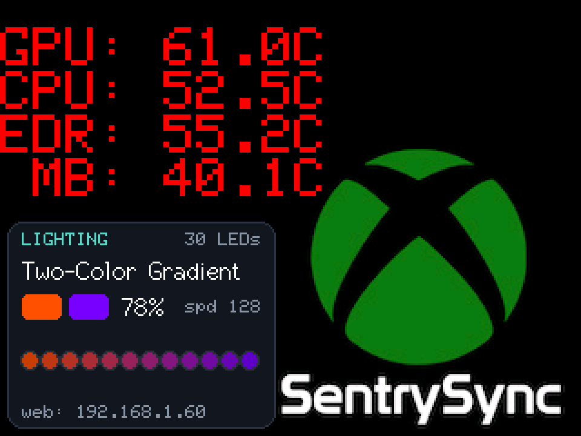
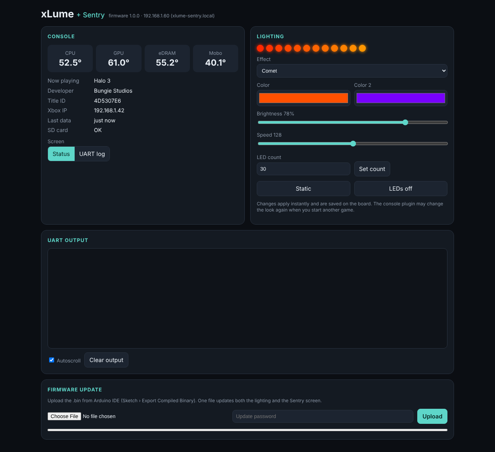
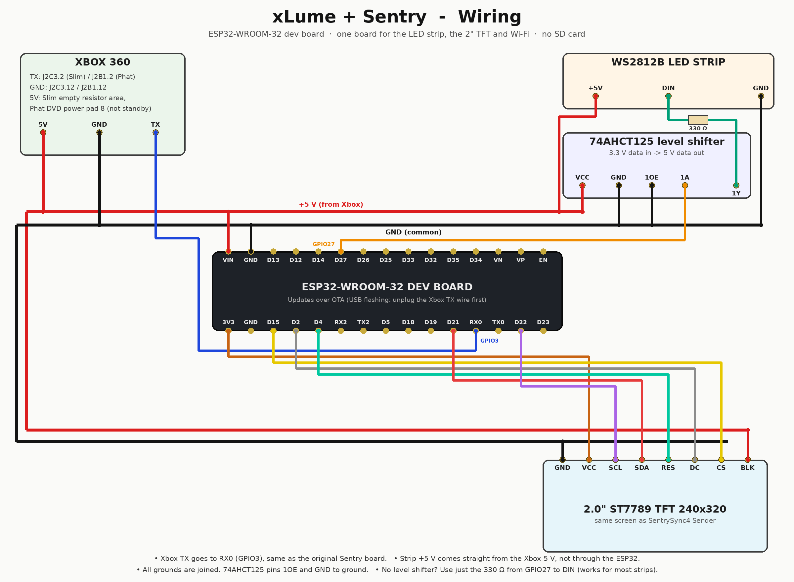

# xLume + Sentry

**One ESP32 for both projects:** the [xLume](https://github.com/xhjuu/xLume) LED controller and the
[Sentry](https://github.com/FreshLabs-Interactive/Sentry) status screen (SentrySync4 Sender, 2" TFT).

| | |
|---|---|
|  |  |
| TFT: Sentry's temperatures + the new **Lighting** panel (effect, colours, brightness, live strip preview) | Web page: console status, **LED controls**, Sentry's UART console, **game list editor**, **firmware upload** |

## How it works

Both projects already listened to the same wire: the Xbox 360's debug UART, which carries
everything the console prints with `DbgPrint` once DashLaunch has `debugout = true`.

```
Xbox TX ──► ESP32 RX0 ────┬─ "[xLume] - ..."  ──► LED engine (own task, never stutters)
                           └─ "[Sentry] ..."   ──► TFT, game list, ESP-NOW remote
                           └─ every line       ──► web console
```

On the console, the **xLume 360 plugin** now does both jobs. It drives the lights and sends
Sentry's temperature, IP and game reports, so the old `sentry.xex` plugin isn't needed. That
plugin hung when unloaded, because it waited on a flag nothing ever set. The new one shuts down
cleanly.

## Parts

- ESP32-WROOM-32 dev board (the one SentrySync4 already uses)
- 2.0" ST7789 240x320 SPI TFT (same as SentrySync4 Sender)
- WS2812B LED strip (the strips xLume recommends)
- 74AHCT125 level shifter, or at least a 330 Ω resistor for the LED data line
- Optional: your SentrySync4 receiver (ESP32-C3 + 0.96" TFT in the controller). It keeps working unchanged.
- Optional: the carrier PCB in `hardware/` (KiCad 8, 39.5 × 65 mm, about the TFT's size: TFT on top, ESP32 underneath), in a level-shifter version and a resistor-only version.

**No SD card needed.** The game list for Now Playing (2,687 titles from Sentry's
`gamelist.txt`) is built into the firmware. Missing or wrongly named games can be added on the
web page.

The old xLume board (ESP8266 / ESP-07S) is no longer needed.

## Wiring



| From | To (ESP32 dev board) | Notes |
|---|---|---|
| Xbox TX (J2C3.2 Slim / J2B1.2 Phat) | **RX0 / GPIO3** | Same wire as the original Sentry board |
| Xbox 5 V | VIN | Slim: empty resistor area. Phat: DVD power pad 8 (not standby) |
| Xbox GND (J2C3.12 / J2B1.12) | GND | All grounds joined |
| LED strip DIN | GPIO27 → 74AHCT125 (1A→1Y) → 330 Ω → DIN | 1OE and GND of the 74AHCT125 to ground, VCC to 5 V |
| LED strip +5 V / GND | Xbox 5 V / GND directly | Not through the ESP32 |
| TFT GND, VCC, SCL, SDA, RES, DC, CS, BLK | GND, 3V3, D22, D21, D4, D2, D15, VIN | Same as SentrySync4 |

Pins can be changed in `config.h` (the TFT's are in the TFT_eSPI setup file).

**RX0 or RX2:** `XBOX_ON_RX0` in `config.h` is `1` (RX0) by default. RX0 is shared with the
board's USB chip. That's fine for OTA updates, but to flash over USB (first install, or recovery
if an update leaves the board off Wi-Fi), **unplug the Xbox TX wire first**. If you'd rather
never have to do that, move the wire to RX2 (GPIO16) and set `XBOX_ON_RX0` to `0`.

## Flashing

1. **Arduino IDE 2** with **esp32 boards 3.2.0** (Boards Manager). That's the version the
   SentrySync4 notes use for the dev board.
2. Libraries (Library Manager): **FastLED** (3.9.x) and **TFT_eSPI** (2.5.43).
   TFT_eSPI needs the same setup as SentrySync4: copy `Setup_ST7789_ESP32_240x320.h`
   from Sentry's `FINAL/libraries/TFT_eSPI/TFT_eSPI_Setups/` and select it in
   `User_Setup_Select.h`. If you already flashed SentrySync4, this is done.
3. Open `firmware/xLumeSentry/xLumeSentry.ino` and edit **`config.h`**:
   Wi-Fi name and password, `OTA_PASSWORD`, your receiver's MAC (`RECEIVER_MAC`, same as
   in SentrySync4), and the LED colour order if needed.
4. Tools menu: Board **ESP32 Dev Module**, Partition Scheme
   **Minimal SPIFFS (1.9MB APP with OTA)**. This one is required: the default partition is
   too small; Sentry's own sketch already used 96% of it. Its small file area holds the game
   titles you add on the web page.
5. Upload over USB the first time, with the Xbox TX wire disconnected from RX0.
   After that, use OTA (below).

**Quick test without editing anything:** `prebuilt/xLumeSentry_v1.1.0_AP-test_merged.bin`
can be flashed at address `0x0` with a web flasher such as https://esp.huhn.me (the one the
xLume README uses). With no Wi-Fi configured it starts its own network, **xLume-Sentry**
(password `xlume360`), and the web page is at http://192.168.4.1.

## Console setup

1. Update to the **xLume 360** app and plugin from the matching `xLume360.zip`.
2. In `launch.ini`: keep `debugout = true`, keep the xLume plugin, and **remove the
   `sentry.xex` plugin line**. The xLume 360 app's Tools tab can check both settings for you.
3. Reboot. Sentry reporting starts at boot even before you've opened the app. The LED side
   waits until you've saved settings in the app once, as before.

The app's Tools tab also has:
- **Send temps, IP and game to Sentry:** on/off.
- **Screen shows: Status / UART log:** switches the TFT live. This is the same `$mode` command
  the Sentry sample app used.

## Using it

- **TFT:** at boot it shows the web address. After that it shows the status screen:
  temperatures top left as before, and a **Lighting** panel bottom left with the current effect,
  both colours, brightness, speed, a 12-dot live preview of the strip and the web address.
  Game changes pop up **Now Playing** for 8 s, with the name from the built-in game list, and
  the Xbox IP for 5 s, like SentrySync4. These pages no longer freeze the board while they're
  shown.
- **Web page:** `http://<ip>/` or `http://xlume-sentry.local/`.
  - **Console:** temperatures, game, title ID, Xbox IP, Status/UART screen switch. If the
    running game isn't in the list, an **add this title** link appears.
  - **Lighting:** effect, both colours, brightness, speed, LED count, Static / Off buttons.
    Changes apply instantly and are saved on the board. The console plugin may change the look
    again when a game starts or ends, and per-game looks win.
  - **UART output:** Sentry's live console, with autoscroll and clear.
  - **Game list:** type a title ID to see the name the board will show. Enter a name and
    developer and press **Save** to add a missing game, or to rename one in the built-in list.
    Your titles are saved on the board, take priority over the built-in list, and survive
    firmware updates. **Download my titles** saves them as a file. **Import a list** loads lines in
    `gamelist.txt` format (`4D5307E6*Halo 3*Bungie`), up to 32 KB (about 600 titles) per file.
  - **Firmware update:** see below.
- **Remote screen (ESP-NOW):** sends the same data packet as SentrySync4, so the receiver
  doesn't need reflashing. As before, the receiver must be on the same Wi-Fi channel as your
  router.

## Changing the built-in game list

Edit `docs/gamelist.txt`, run `python3 tools/make_game_table.py`, and rebuild. For one-off
additions, the web page is easier.

## Updating the firmware (one update for both halves)

Both halves are a single firmware, so one update covers the lights and the screen:
- **Arduino IDE:** the board appears as a network port called `xlume-sentry`. Upload as usual;
  it asks for `OTA_PASSWORD`.
- **Web page:** in Arduino IDE use *Sketch › Export Compiled Binary*, then upload
  `build/esp32.esp32.esp32/xLumeSentry.ino.bin` (the app `.bin`, not `merged.bin`) on the
  web page with the same password.

The TFT shows a progress bar either way, and the board restarts when the upload finishes.
Your LED look and settings stay.

## What's different from the originals

- **LED effects are recreations.** xLume's firmware is only published as a compiled binary,
  so the 23 effects were rewritten for the ESP32 from their names. The command protocol is
  identical: it was decoded from `xLumeV2.bin`, so the original app, the xLume 360 app and
  the plugin all work unchanged. Speed: 128 is normal, 255 is about twice as fast.
- **Saving:** the look is saved 3 s after the last change, like the original, but to the
  ESP32's wear-levelled NVS flash.
- **No SD card:** Sentry's `gamelist.txt` (2,687 titles) is built into the firmware as a sorted
  table, so a lookup is instant instead of a scan through a file on the card. Names are shown in
  plain ASCII, because that's all the TFT font can draw: ™ and ® are dropped, and accents are
  removed. The 28 titles whose names are all Japanese show as "(Japanese title)"; rename them
  on the web page if you like. The ESP-NOW packet still reports "SD OK", so the remote screen
  shows no warning. GPIO 5, 18, 19 and 23 are free.
- **Timed screens instead of `delay()`:** the boot, IP and Now Playing screens are timed, so
  the lights, web page and OTA keep running while they show.
- **Faster background redraw:** the background now redraws row by row instead of pixel by
  pixel. The temperature text no longer cuts into the logo.
- **The xLume 360 app shows as "xLume 360"** on the Now Playing screen even though it isn't in
  `gamelist.txt`.

## Project layout

```
firmware/xLumeSentry/   the Arduino sketch
  config.h              your settings
  protocol.*            xLume + Sentry line parsers (plain C++, unit-tested)
  led_engine.*          LED effects, own FreeRTOS task, NVS save
  sentry.*              temps, game lookup, ESP-NOW, web console buffer
  gamedb.*              built-in + custom game titles (plain C++, unit-tested)
  game_table.h          the built-in list, generated from docs/gamelist.txt
  display.*             TFT pages + lighting panel
  web.*, web_page.h     web server and page
docs/                   wiring diagram, previews, gamelist.txt (source of the built-in list)
hardware/               KiCad 8 carrier PCBs (level shifter / 330R) + generator scripts
prebuilt/               test binary (AP mode)
tests/                  host tests (run_tests.sh)
tools/                  game table, diagram + TFT preview generators
```

## Status

- **Compiles cleanly** for the ESP32 Dev Module (esp32 3.2.0, FastLED 3.9.20,
  TFT_eSPI 2.5.43) with no warnings in the project code. It uses 1.43 MB, which is 72% of the
  OTA app partition, with the game list included. The list lives in flash, not RAM.
- **Tested off-hardware:**
  - 36 parser tests.
  - 42 game-list tests. Every title in `gamelist.txt` is found, and all 2,177 plain-ASCII
    entries match the file exactly.
  - 49 end-to-end checks that run the real xLume 360 plugin logic into the firmware's parsers.
  - The web page, including adding, editing, deleting and importing titles, was checked in a
    real browser at desktop and phone sizes. The TFT layout was rendered with TFT_eSPI's real fonts.
- **Not yet run on real hardware.** If reds and blues come out swapped on the TFT, change
  `TFT_SWAP_RED_BLUE`. If the strip shows wrong colours, change `LED_COLOR_ORDER`.

## Credits

Combined and redesigned by FreshLabs Interactive. Sentry by Element, SentrySync by Element,
ViolentLamb, Charly Gaber and JFresh. xLume v1 & v2 by Element18592 and xhjuu (MIT).
